# omicstat figure gallery

Synthetic fixtures rendered with the shared figure layer (style v1.3.0). Regenerate with `Rscript skills/_shared/tests/make_figure_gallery.R`.

## 01_volcano (`volcano`, 89 x 92 mm)

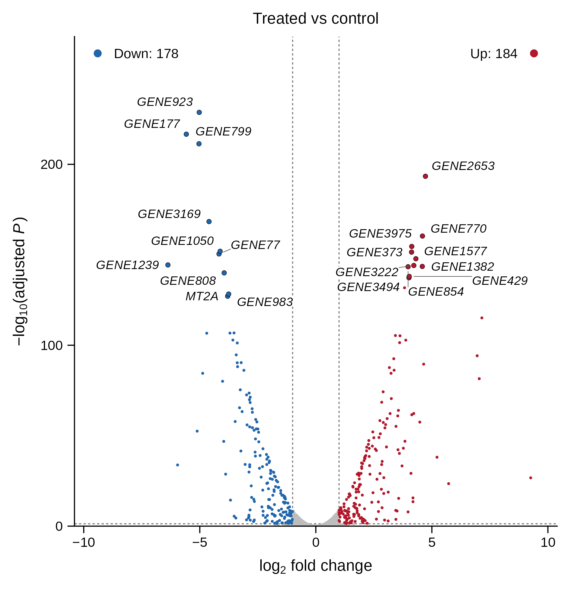

Volcano plot (Treated vs control). Each point is one feature; 3,824 features with an adjusted P value are shown (176 features with adjusted P = NA after independent filtering are not shown). Red, up-regulated (n = 184); blue, down-regulated (n = 178); grey, not significant (n = 3,462). Significance: adjusted P < 0.05 and |log2 fold change| > 1 (DESeq2 Wald test, apeglm shrinkage, Benjamini-Hochberg). Dashed lines mark these thresholds. The 10 most significant features per direction are labelled.

## 02_ma (`ma`, 89 x 70 mm)

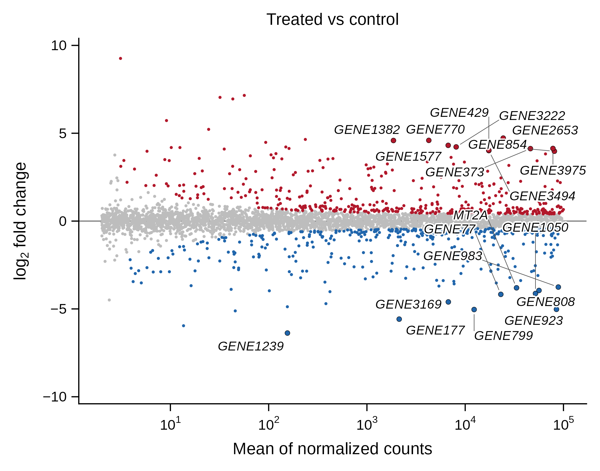

MA plot (Treated vs control). x axis, mean of normalized counts (log10 scale); y axis, log2 fold change. Red, up-regulated (n = 434); blue, down-regulated (n = 422); adjusted P < 0.05. 

## 03_pca (`pca`, 89 x 70 mm)

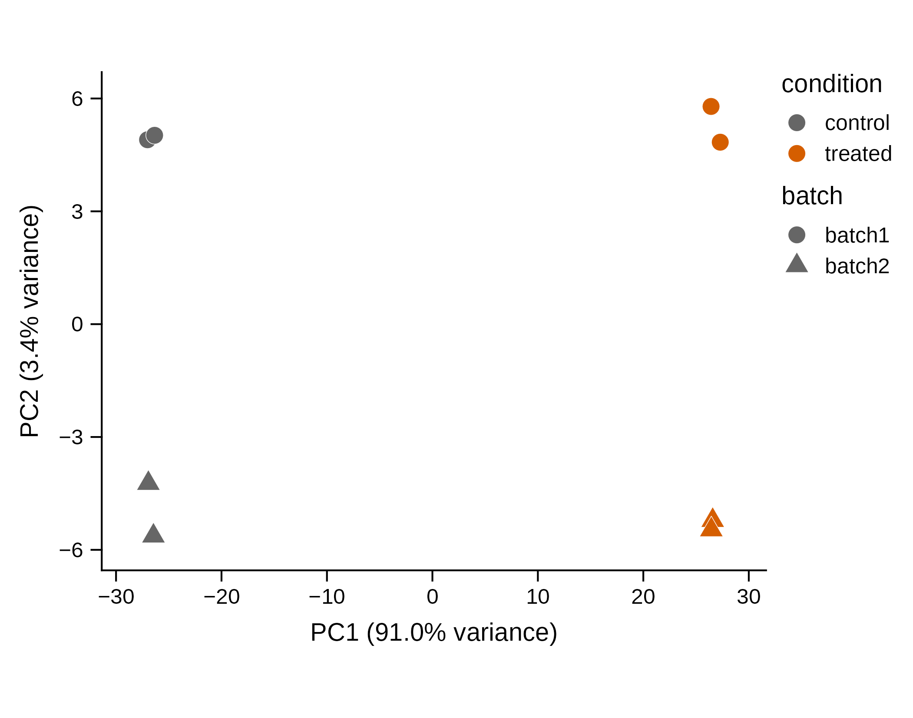

Principal component analysis of 8 samples using the 500 most variable features (centred, not scaled; axes NOT on a common scale because the two components span very different ranges). Each point is one sample, coloured by condition and shaped by batch. Percentages give the variance explained by each component.

## 04_sample_distance (`sample_distance`, 89 x 75 mm)

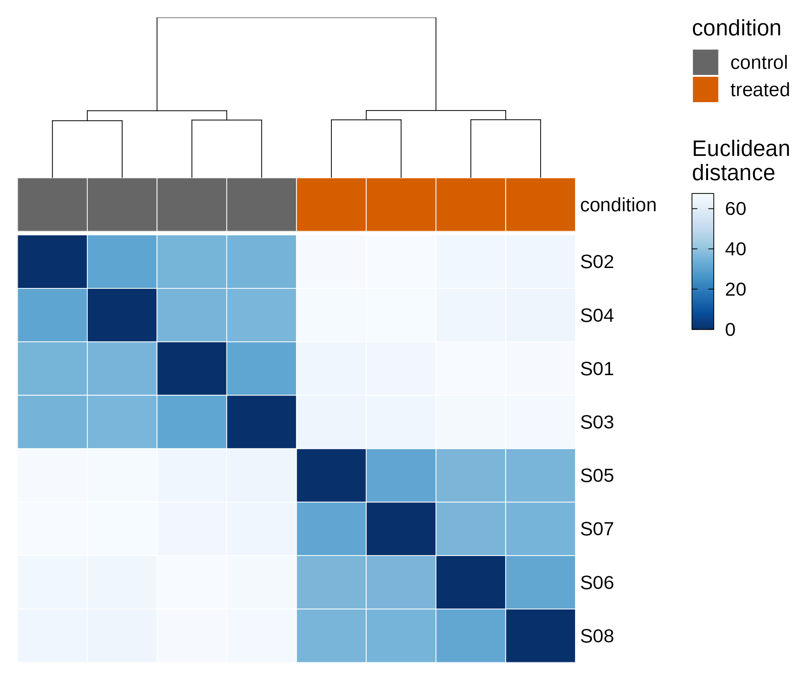

Sample-to-sample Euclidean distances on transformed expression values (8 samples). Samples are ordered by hierarchical clustering (complete linkage); darker blue indicates more similar samples. The top bar shows condition.

## 05_top_heatmap (`top_heatmap`, 89 x 118 mm)

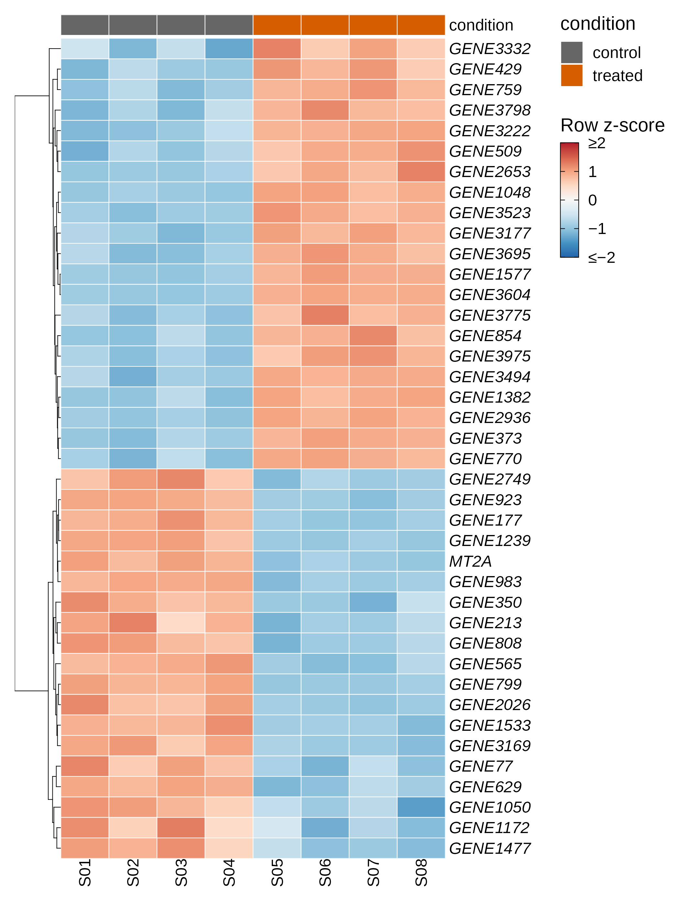

Expression of the 40 features with the smallest adjusted P values. Values are row z-scores of transformed expression, clipped at ±2; rows are ordered by hierarchical clustering (Euclidean distance, complete linkage) and columns by condition. 0 cells were clipped.

## 06_ora_dotplot (`enrichment_dotplot`, 89 x 100 mm)

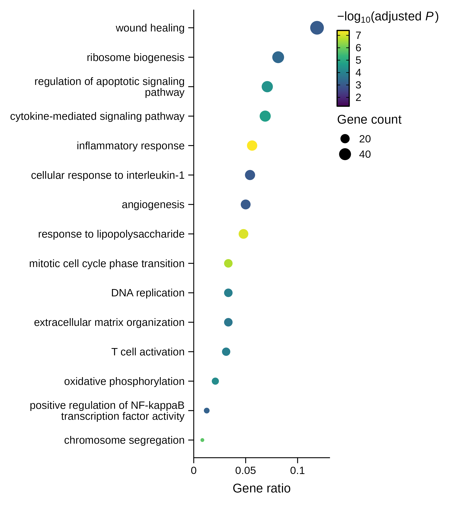

Over-representation analysis (GO biological process). Selection: the 15 gene sets with the smallest adjusted P among the 20 with adjusted P < 0.05 (ties broken by larger gene ratio, then term ID); ordered by gene ratio, largest at the top (ties by adjusted P, then term ID). Gene ratio = input genes in the set / input genes annotated in the database. Dot colour, -log10 adjusted P; dot size, number of input genes in the set.

## 07_gsea_dotplot (`enrichment_dotplot`, 89 x 100 mm)

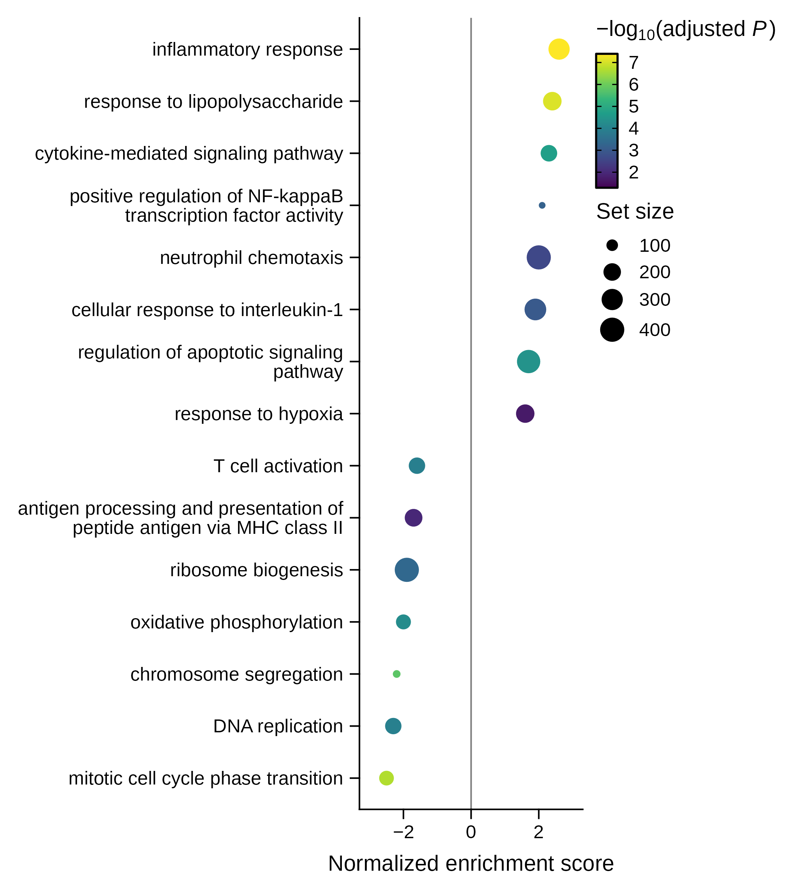

Gene set enrichment analysis (GO biological process). Selection: the 15 gene sets with the largest |NES| among the 20 with adjusted P < 0.05 (ties broken by smaller adjusted P, then term ID); ordered by NES, largest at the top (ties by adjusted P, then term ID). NES from preranked GSEA (enrichment score normalized to the mean of permuted scores of the same sign). Dot colour, -log10 adjusted P; dot size, gene set size.

## 08_nes_bar (`nes_bar`, 89 x 102.8 mm)

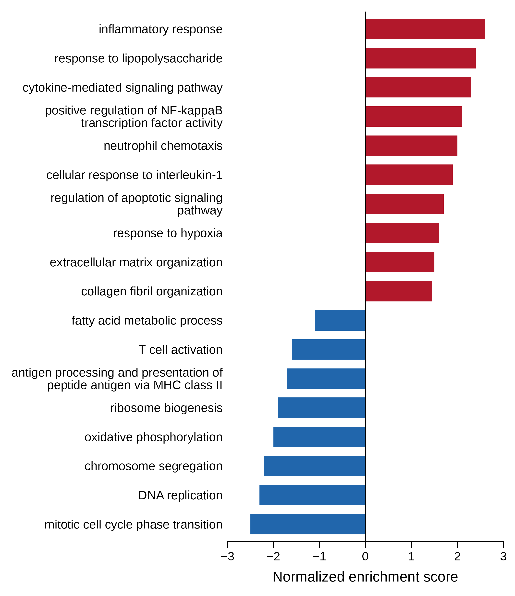

Normalized enrichment scores (GO biological process). Selection: in each direction, up to 10 gene sets with the largest |NES| among the 20 with adjusted P < 0.05 (ties broken by smaller adjusted P, then term ID); 10 positive and 8 negative sets shown; bars ordered by NES, largest at the top (ties by term ID). NES from preranked GSEA (enrichment score normalized to the mean of permuted scores of the same sign). Red, enriched among up-regulated genes (NES > 0); blue, among down-regulated genes (NES < 0).

## 09_gsea_curve (`gsea_curve`, 89 x 62 mm)

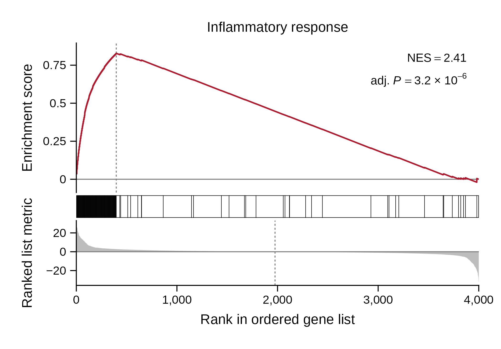

GSEA running enrichment score for Inflammatory response. Top, running enrichment score (weighted Kolmogorov–Smirnov statistic, weight 1); dashed line, position of the maximum deviation. Middle, positions of the 140 set members in the ranked list of 4,000 genes. Bottom, ranking metric; dashed line, where it crosses zero. NES = 2.41, adjusted P = 3.2 × 10^−6.

## 10_enrich_compare (`enrichment_compare`, 89 x 63.4 mm)

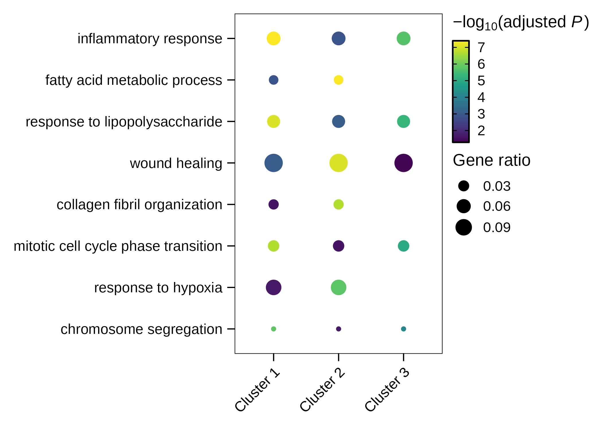

Comparison of enriched gene sets across groups. Selection: in each group, up to 4 gene sets with the smallest adjusted P among those with adjusted P < 0.05 (ties broken by larger gene ratio, then term ID); the union of 8 sets is shown; rows grouped by the first group (in axis order) in which the set has adjusted P < 0.05, then ordered by its smallest adjusted P across groups (ties by term ID). Gene ratio = input genes in the set / input genes annotated in the database. Dot colour, -log10 adjusted P; dot size, gene ratio. An empty position means the set is not significant in that group.

## 11_umap_celltype (`embedding`, 89 x 80 mm)

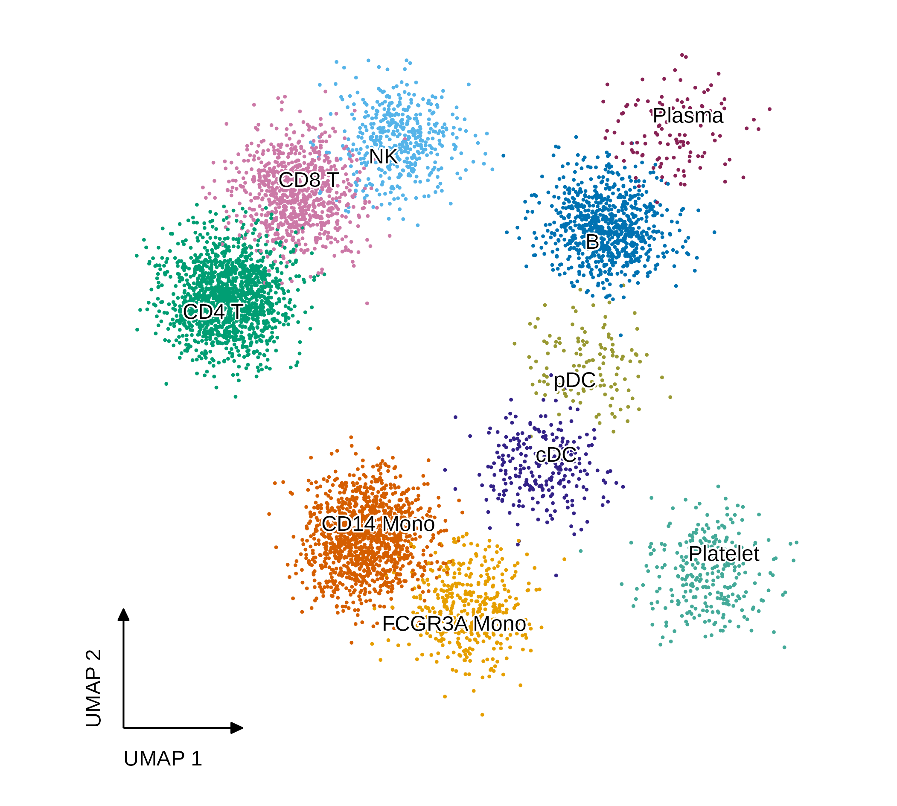

UMAP embedding of 6,000 cells coloured by celltype (10 categories). Category names are placed at the median position of their cells.

## 12_umap_legend (`embedding`, 89 x 80 mm)

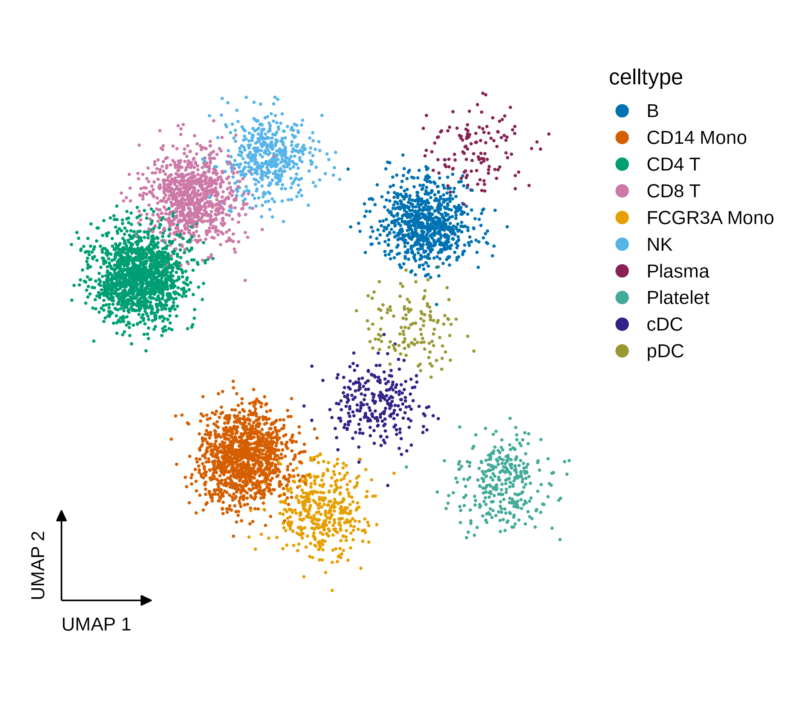

UMAP embedding of 6,000 cells coloured by celltype (10 categories). 

## 13_feature_umap (`feature_embedding`, 89 x 70 mm)

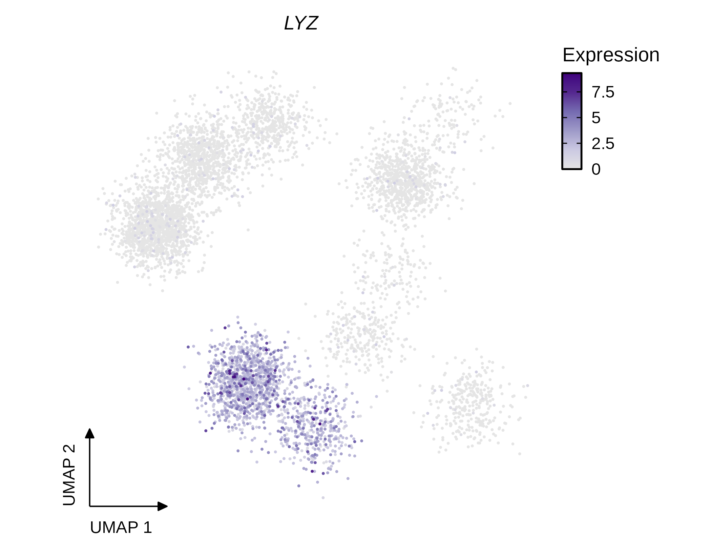

LYZ expression on the UMAP embedding (6,000 cells); cells are drawn in order of increasing expression.

## 14_marker_dotplot (`marker_dotplot`, 120 x 60 mm)

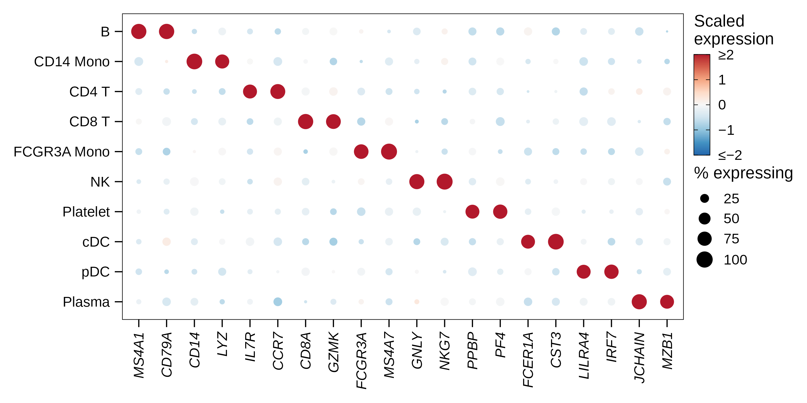

Marker gene expression by cluster (10 clusters; n = 120–1,440 cells per cluster). Dot size, percentage of cells in the cluster with non-zero expression; colour, mean expression scaled across clusters (z-score, clipped at ±2); values beyond ±2 shown at the limit (20 of 200 dots). Mean expression definition: mean of log-normalised values. Markers describe clusters and are not tests of differences between conditions.

## 15_proportion_bar (`proportion_bar`, 89 x 65 mm)

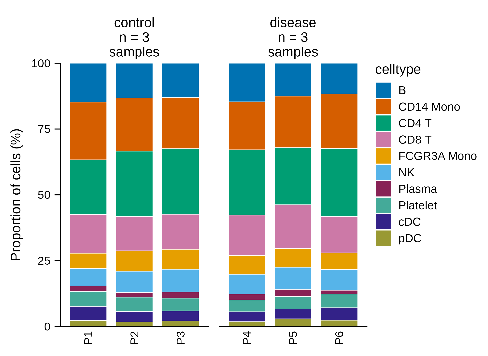

Proportion of cells assigned to each celltype in each sample (6 samples, 6,000 cells), grouped by condition (control, n = 3 samples; disease, n = 3 samples); n = 966–1,068 cells per sample. Each bar is one sample, the unit of replication. Proportions are descriptive; differences between conditions are tested separately at the sample level.

## 16_qc_violin (`qc_violin`, 89 x 115 mm)

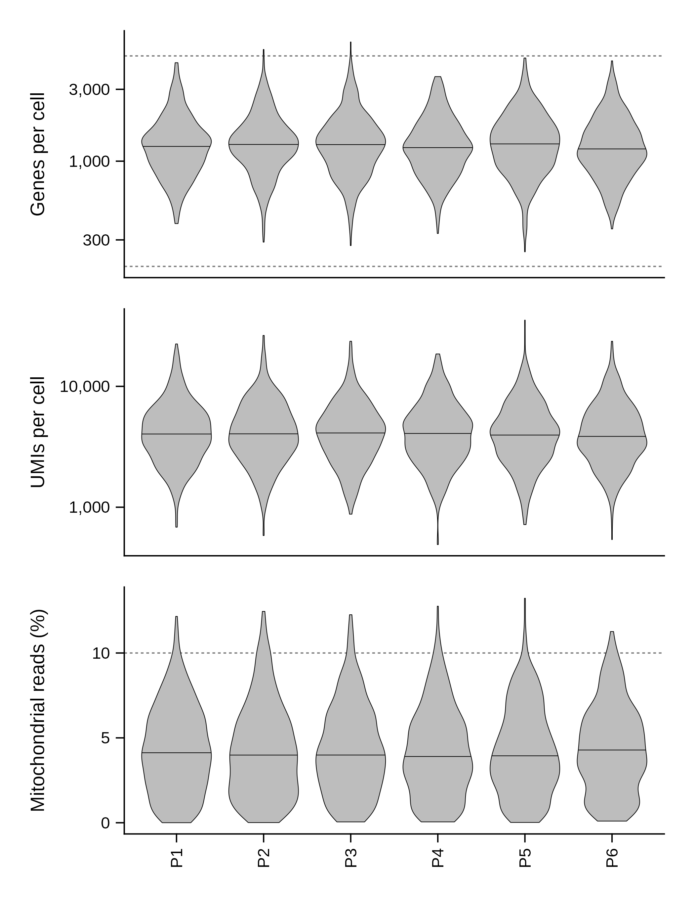

Per-cell quality-control metrics by sample (6 samples, 3,000 cells before filtering; n = 477–518 cells per sample). Violins are scaled to equal width; horizontal line inside each violin, median; dashed lines, filtering thresholds; Genes per cell and UMIs per cell on a log10 axis.

## 17_score_violin (`score_violin`, 89 x 55 mm)

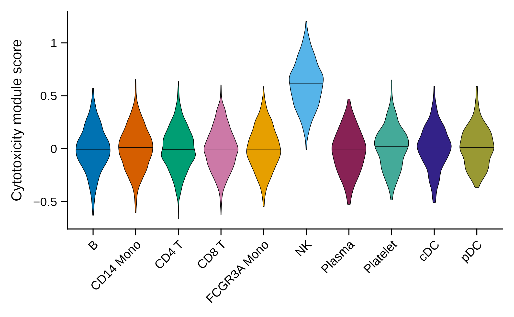

Cytotoxicity module score per cell by celltype (6,000 cells; n = 126–1,429 cells per group). Violins are scaled to equal width; horizontal line, median. Cells are not independent replicates: cells from the same sample share its biology and processing, so differences between groups must be tested at the sample level, not across cells.

## 18_module_trait (`module_trait`, 89 x 81 mm)

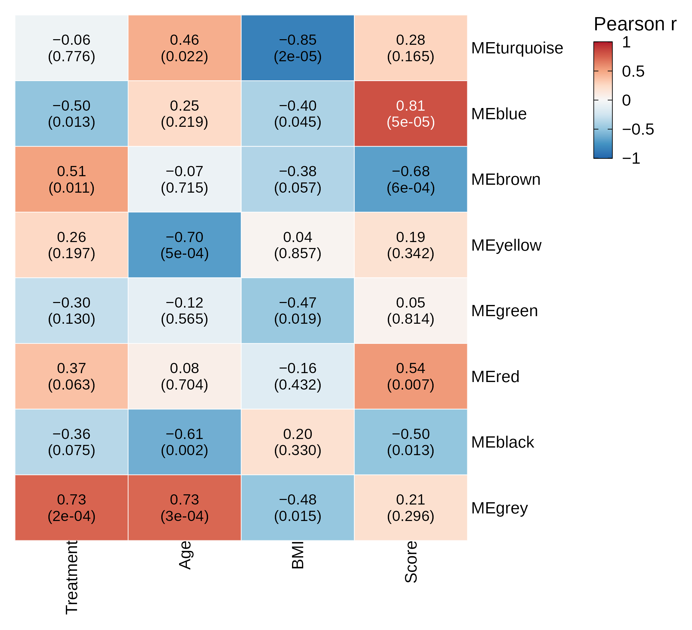

Correlation between module eigengenes (8 modules, rows) and traits (4, columns). Each cell gives the Pearson correlation coefficient and, in parentheses, its unadjusted P value; colour encodes r from −1 (blue) to 1 (red).

## 19_soft_threshold (`soft_threshold`, 120 x 50 mm)

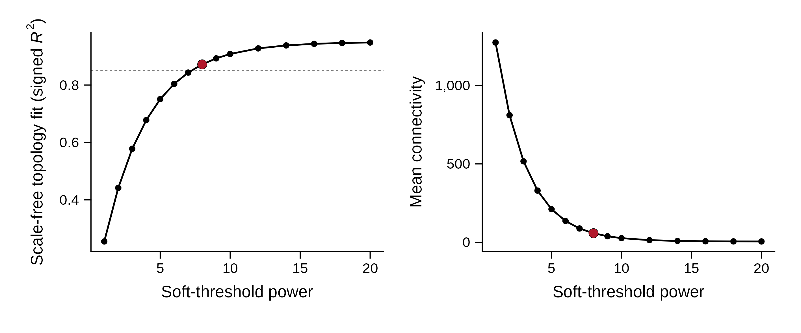

Choice of the soft-thresholding power. Left, scale-free topology fit index (signed R2) against power; dashed line, R2 = 0.85. Right, mean connectivity. The chosen power (8) is highlighted in red.

## 20_oncoplot (`oncoplot`, 183 x 73.4 mm)

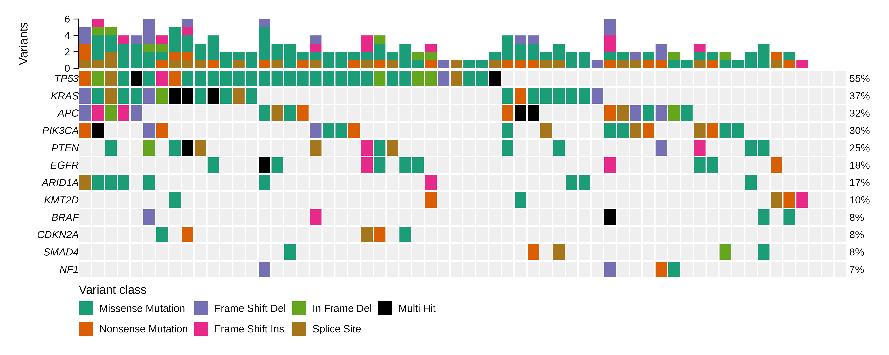

Somatic variant landscape of the 12 most frequently mutated genes across 60 samples. Each column is a sample (sorted by mutation pattern) and each row a gene; percentages give the fraction of samples mutated. Top, number of variants per sample. Multi hit, more than one variant in the gene.

## 21_heatmap_split (`heatmap`, 120 x 110 mm)

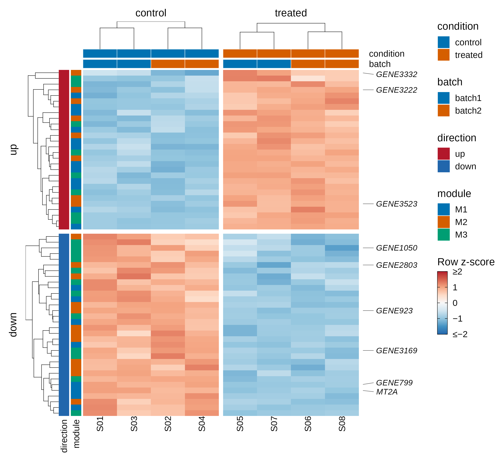

Heatmap of 60 rows and 8 columns; colour, Row z-score. rows and columns are ordered by hierarchical clustering (Euclidean distance, complete linkage, within each group). Rows are split into 2 groups (up, down) separated by gaps. Columns are split into 2 groups (control, treated) separated by gaps. Left bars: direction, module. Top bars: condition, batch. 9 selected rows are labelled. Values are clipped at ±2 (0 cells).

## 22_stacked_violin (`stacked_violin`, 120 x 70 mm)

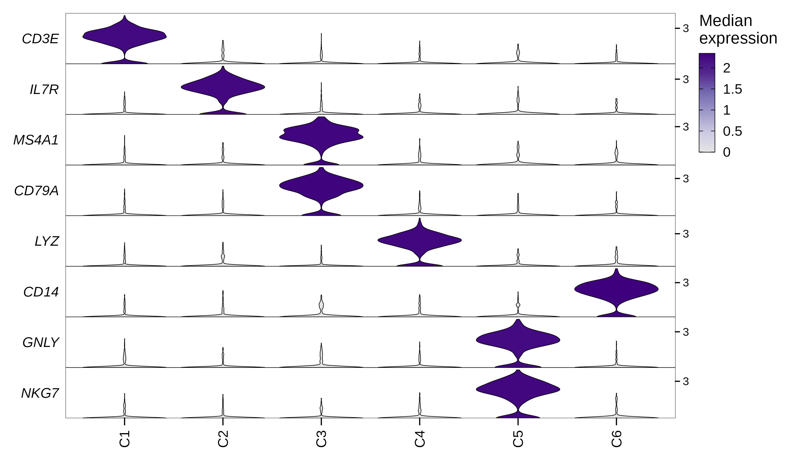

Expression of 8 genes (rows) across 6 clusters (columns; 2,400 cells). Each violin shows the distribution of per-cell values of one gene in one cluster (kernel density, width scaled to be equal across violins); each row has its own axis (right, Expression; starts at 0 at the row's lower edge, one labelled tick per row). Violin colour, median expression of the gene in that group.

## 23_ridge (`ridge`, 89 x 64 mm)

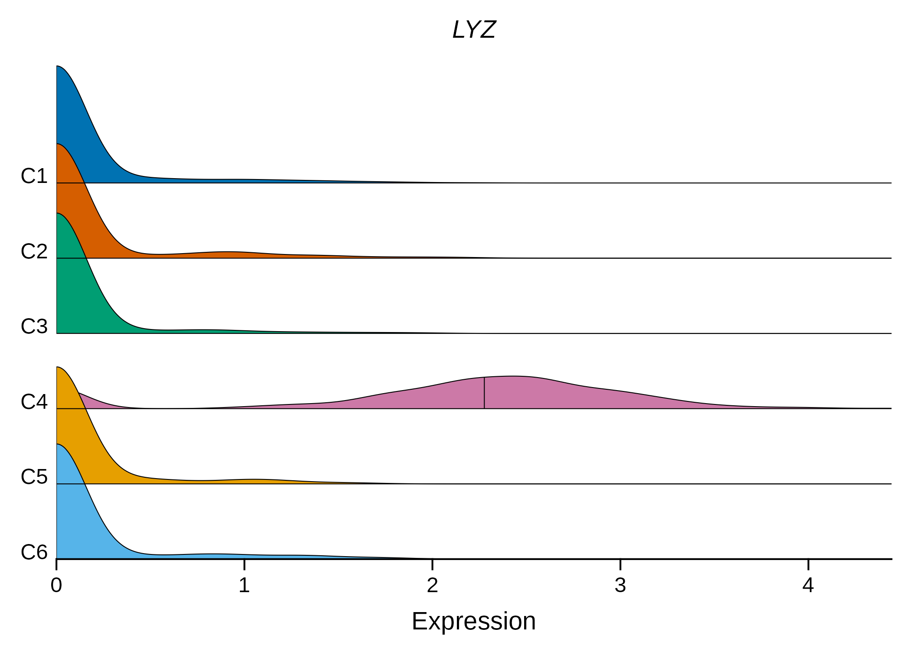

LYZ by cluster (2,400 cells). Each ridge is a Gaussian kernel density of the per-cell values (one bandwidth for all groups, 0.16, Silverman's rule on the pooled values); ridge heights share one scale. Vertical line, median.

## 24_highlight_embedding (`highlight_embedding`, 89 x 80 mm)

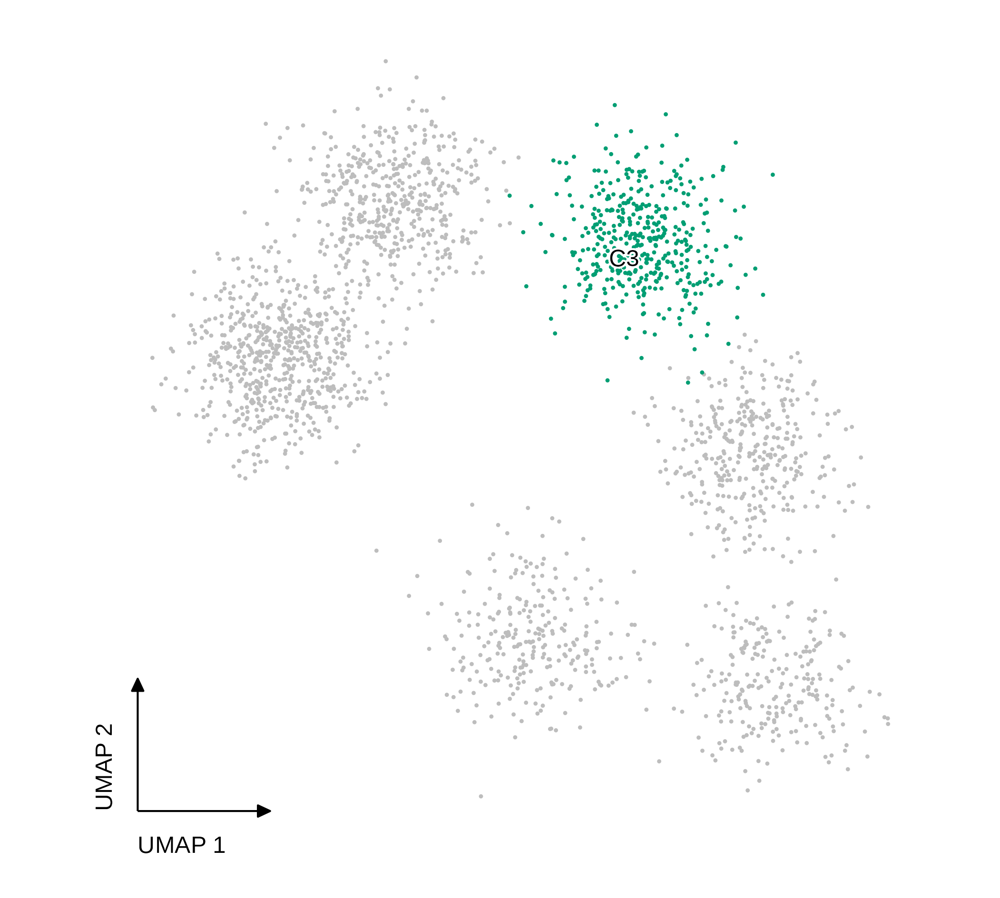

UMAP embedding of 2,400 cells; C3 highlighted in colour (C3, n = 436, 18.2%), all other cells in grey and drawn underneath.

## 25_alluvial (`alluvial`, 89 x 80 mm)

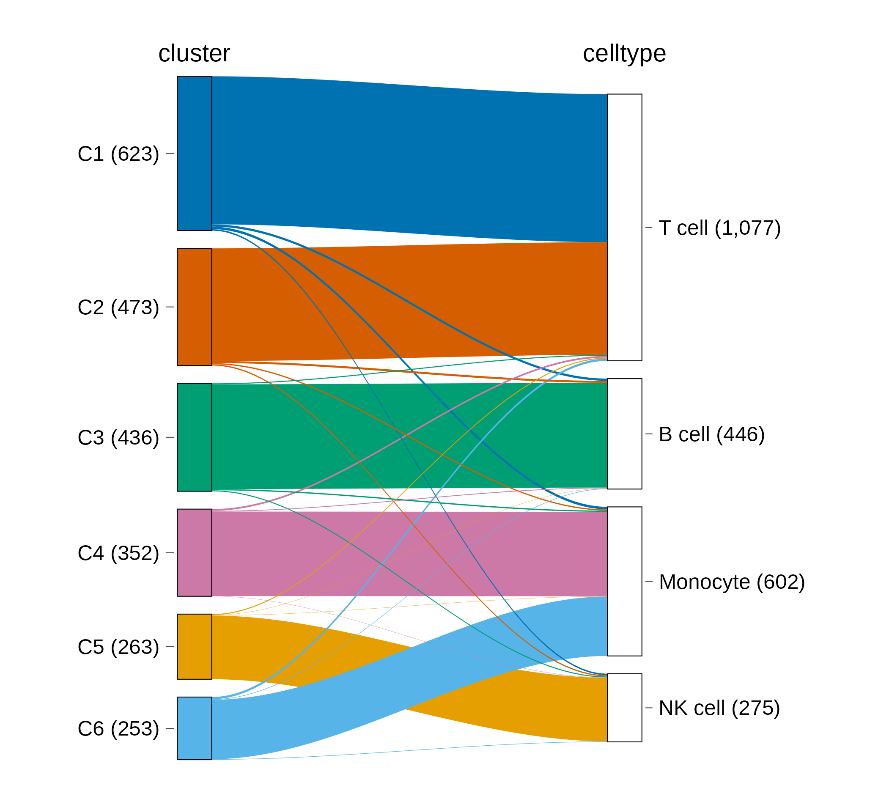

Correspondence between cluster and celltype for 2,400 cells. Boxes are categories (height proportional to the number of cells, given in parentheses); bands connect the same cells across annotations, have widths proportional to their cell counts and are coloured by cluster. Categories of celltype are ordered to follow their cells' positions on the preceding axis.

## 26_cluster_tree_dotplot (`cluster_tree_dotplot`, 120 x 55 mm)

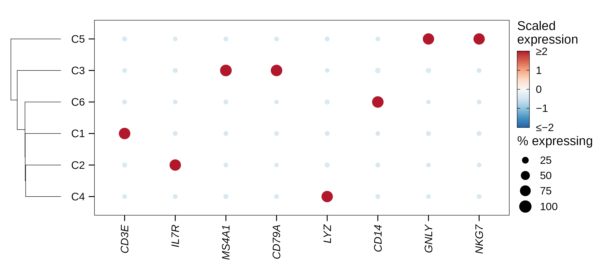

Clusters are ordered by hierarchical clustering (Euclidean distance, complete linkage) of their marker expression profiles (avg_exp of the plotted genes); the tree is drawn on the left. Marker gene expression by cluster (6 clusters). Dot size, percentage of cells in the cluster with non-zero expression; colour, mean expression scaled across clusters (z-score, clipped at ±2); values beyond ±2 shown at the limit (8 of 48 dots). Mean expression definition: mean of log-normalised values. Markers describe clusters and are not tests of differences between conditions.

## 27_density_embedding (`density_embedding`, 89 x 70 mm)

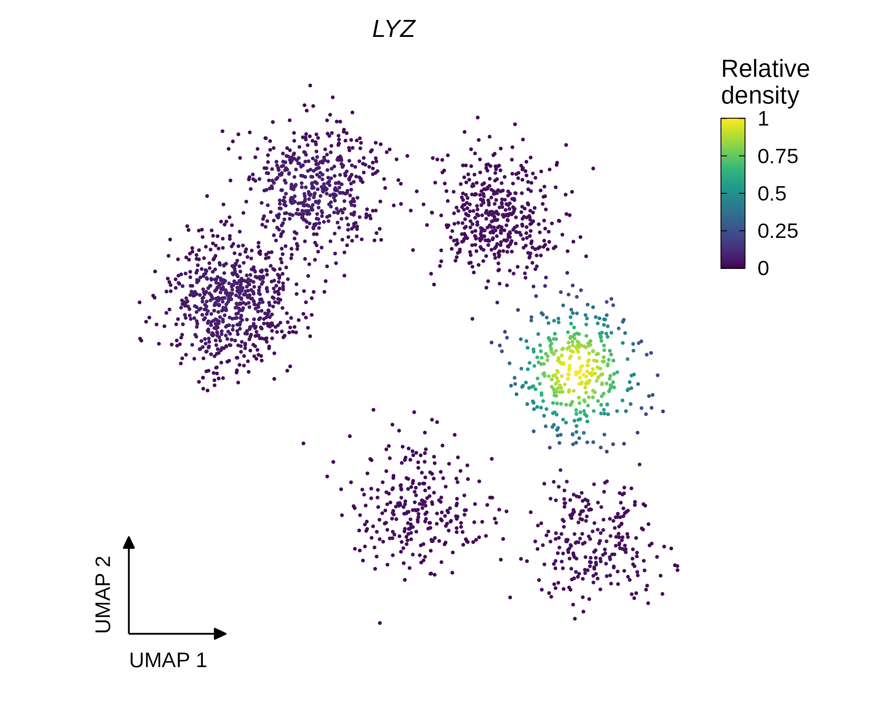

Expression-weighted density of LYZ on the UMAP embedding (2,400 cells, 523 with non-zero expression). Two-dimensional Gaussian kernel density (MASS::kde2d formulation, 100 x 100 grid, normal-reference bandwidths 3.82 and 3.32), each cell weighted by its expression; colour, density at each cell relative to the maximum. Cells are drawn in order of increasing density.

## 28_cnet (`cnet`, 120 x 89 mm)

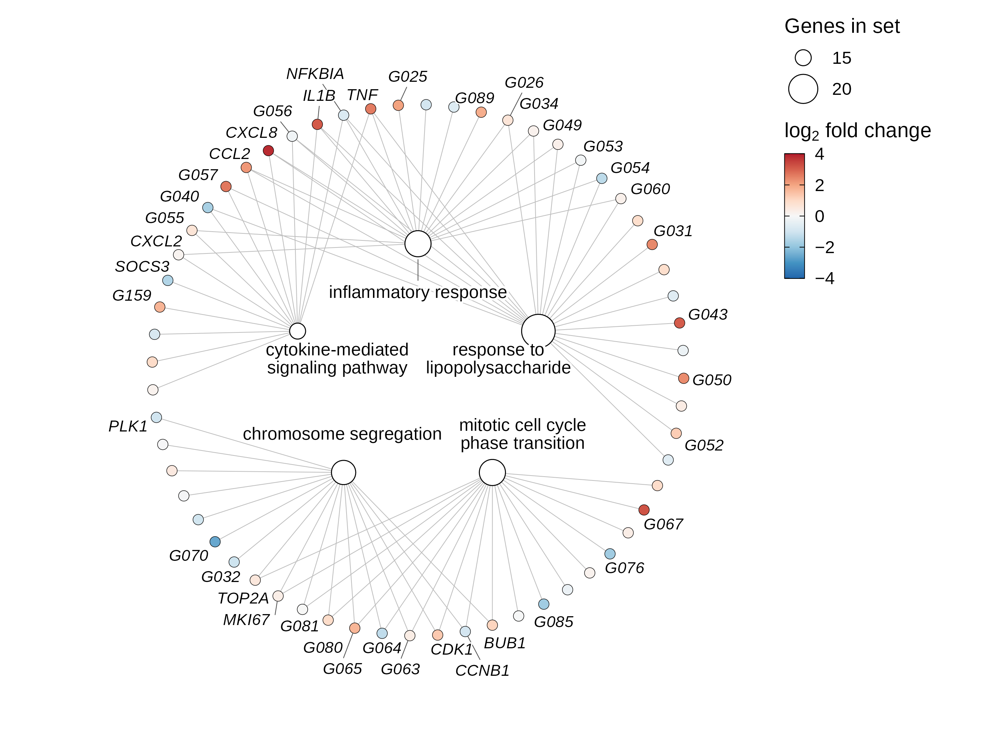

Gene–concept network of the 5 gene sets with the smallest adjusted P (adjusted P < 0.05). Open circles, gene sets (size, number of their genes in the network); small circles, the 60 genes coloured by log2 fold change (symmetric scale); lines connect each gene to the sets that contain it. Sets are placed clockwise from the top in order of adjusted P; each gene sits on the outer ring near the mean direction of its sets. 40 of 60 genes are labelled (genes in several sets first, then by |log2 fold change|).

## 29_emap (`emap`, 120 x 85 mm)

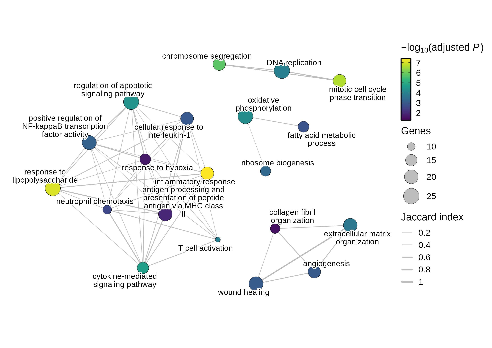

Enrichment map of the 20 gene sets with the smallest adjusted P (adjusted P < 0.05). Nodes are gene sets (colour, -log10 adjusted P; size, number of genes); an edge joins two sets whose Jaccard index (shared genes / all genes of the two sets) is at least 0.2 (edge width, Jaccard index; 53 edges, 0 unconnected sets). Positions are a two-dimensional classical multidimensional scaling of 1 − Jaccard index, with overlapping nodes pushed apart; the axes have no units.

## 30_term_tree (`term_tree`, 120 x 106 mm)

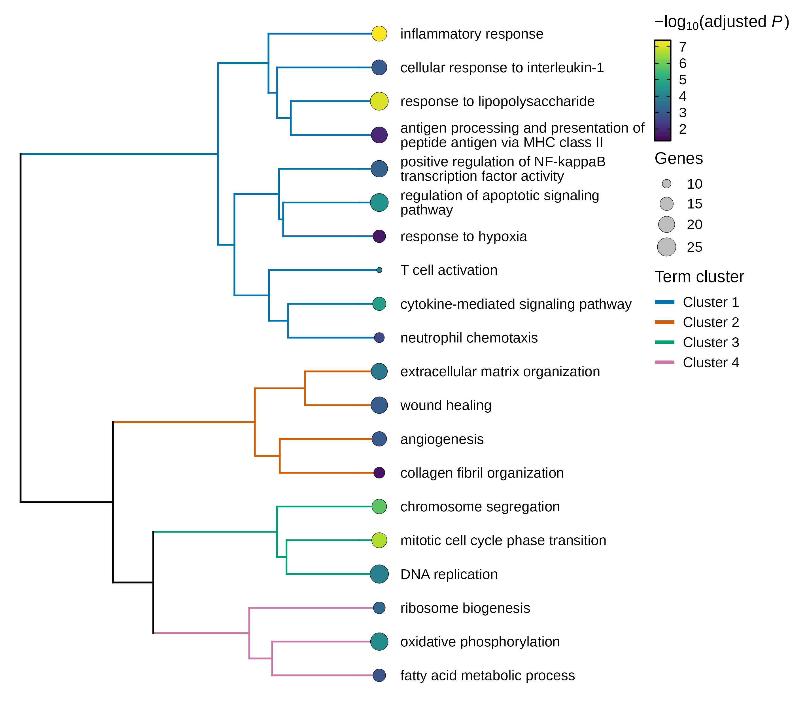

Hierarchical clustering of the 20 gene sets with the smallest adjusted P (adjusted P < 0.05) by gene overlap (distance 1 − Jaccard index, ward.D linkage), cut into 4 clusters (branch colours). Dot colour, -log10 adjusted P; dot size, number of genes in the set.

## 31_gsea_multi (`gsea_multi`, 89 x 90 mm)

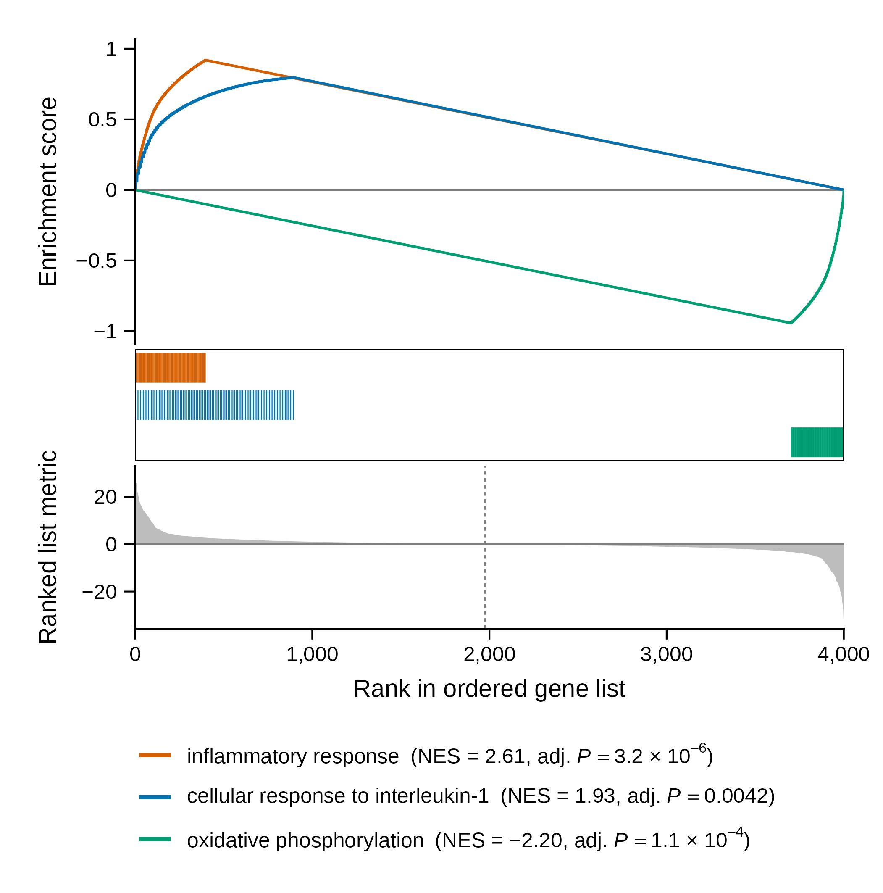

GSEA running enrichment scores of 3 gene sets in one ranked list of 4,000 genes. Top, running enrichment score (weighted Kolmogorov–Smirnov statistic, weight 1), one line per set. Middle, positions of the set members, one row per set in legend order. Bottom, ranking metric; dashed line, where it crosses zero. Sets: inflammatory response (80 genes in the list, NES = 2.61, adjusted P = 3.2 × 10^−6); cellular response to interleukin-1 (100 genes in the list, NES = 1.93, adjusted P = 0.0042); oxidative phosphorylation (75 genes in the list, NES = −2.20, adjusted P = 1.1 × 10^−4).

## F1_composite_bulk (`composite`, 183 x 75 mm)

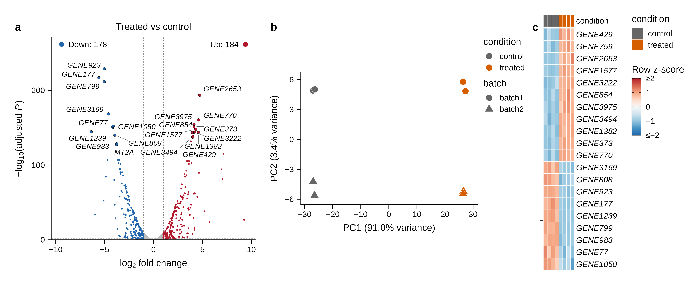

**a**, Volcano plot (Treated vs control). Each point is one feature; 3,824 features with an adjusted P value are shown (176 features with adjusted P = NA after independent filtering are not shown). Red, up-regulated (n = 184); blue, down-regulated (n = 178); grey, not significant (n = 3,462). Significance: adjusted P < 0.05 and |log2 fold change| > 1 (DESeq2 Wald test, apeglm shrinkage, Benjamini-Hochberg). Dashed lines mark these thresholds. The 10 most significant features per direction are labelled. **b**, Principal component analysis of 8 samples using the 500 most variable features (centred, not scaled; axes NOT on a common scale because the two components span very different ranges). Each point is one sample, coloured by condition and shaped by batch. Percentages give the variance explained by each component. **c**, Expression of the 20 features with the smallest adjusted P values. Values are row z-scores of transformed expression, clipped at ±2; rows are ordered by hierarchical clustering (Euclidean distance, complete linkage) and columns by condition. 0 cells were clipped.

## F2_composite_singlecell (`composite`, 183 x 80 mm)

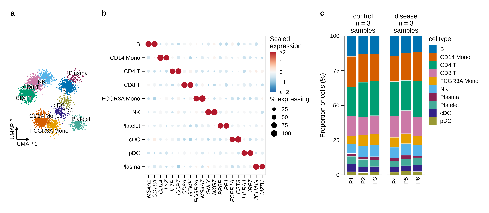

**a**, UMAP embedding of 6,000 cells coloured by celltype (10 categories). Category names are placed at the median position of their cells. **b**, Marker gene expression by cluster (10 clusters; n = 120–1,440 cells per cluster). Dot size, percentage of cells in the cluster with non-zero expression; colour, mean expression scaled across clusters (z-score, clipped at ±2); values beyond ±2 shown at the limit (20 of 200 dots). Mean expression definition: mean of log-normalised values. Markers describe clusters and are not tests of differences between conditions. **c**, Proportion of cells assigned to each celltype in each sample (6 samples, 6,000 cells), grouped by condition (control, n = 3 samples; disease, n = 3 samples); n = 966–1,068 cells per sample. Each bar is one sample, the unit of replication. Proportions are descriptive; differences between conditions are tested separately at the sample level.

